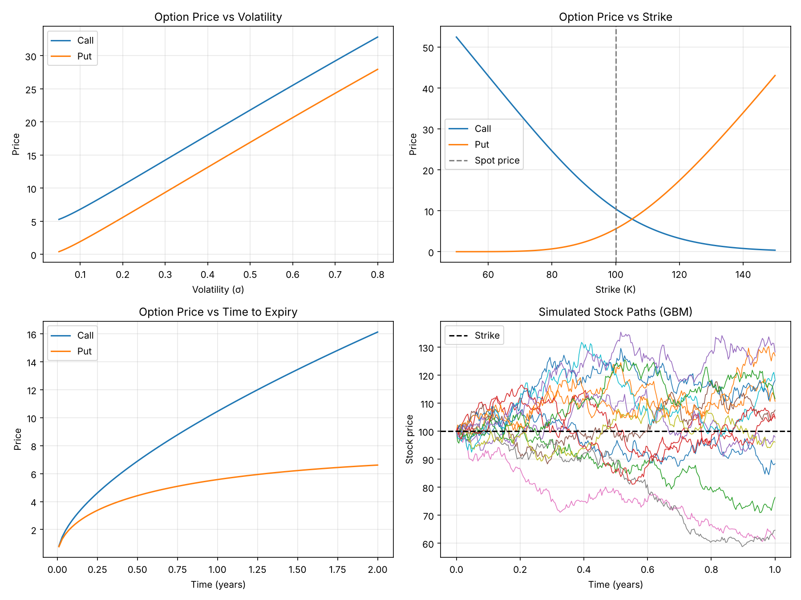

# Black–Scholes Option Pricing Calculator

A small Python project that prices European call and put options three ways and checks they agree.

## What it does
1. **Black–Scholes formula**: closed-form prices for calls and puts.
2. **Put–call parity check**: verifies `C − P = S − K·e^(−rT)`.
3. **Monte Carlo pricing**: simulates 200,000 final stock prices under Geometric Brownian Motion and averages the discounted payoffs.
4. **Plots**: option price vs volatility, strike, and time to expiry, plus sample GBM stock paths.

## Results (S=100, K=100, T=1, r=5%, σ=20%)

| | Black–Scholes | Monte Carlo | Error |
|---|---|---|---|
| Call | 10.4506 | 10.4634 | 0.12% |
| Put | 5.5735 | 5.5889 | 0.28% |

Put–call parity holds exactly (difference 0.0).



## Run it
```bash
pip install numpy scipy matplotlib
python option_pricing.py
```

## Key formulas
- d1 = [ln(S/K) + (r + σ²/2)T] / (σ√T),  d2 = d1 − σ√T
- Call = S·N(d1) − K·e^(−rT)·N(d2)
- Put = K·e^(−rT)·N(−d2) − S·N(−d1)
- GBM: S_T = S·exp((r − σ²/2)T + σ√T·Z),  Z ~ N(0,1)
